# Répertoire des Diagrammes UML et Architecture - CarRental

Ce dossier regroupe l'ensemble des diagrammes d'architecture et de conception UML du projet **CarRental**, conformes aux exigences de la validation intermédiaire (Séance 4).

Chaque diagramme est disponible au format source **PlantUML (`.puml`)** et directement visualisable en **Mermaid** ci-dessous.

---

## 1. Diagramme d'Architecture Globale

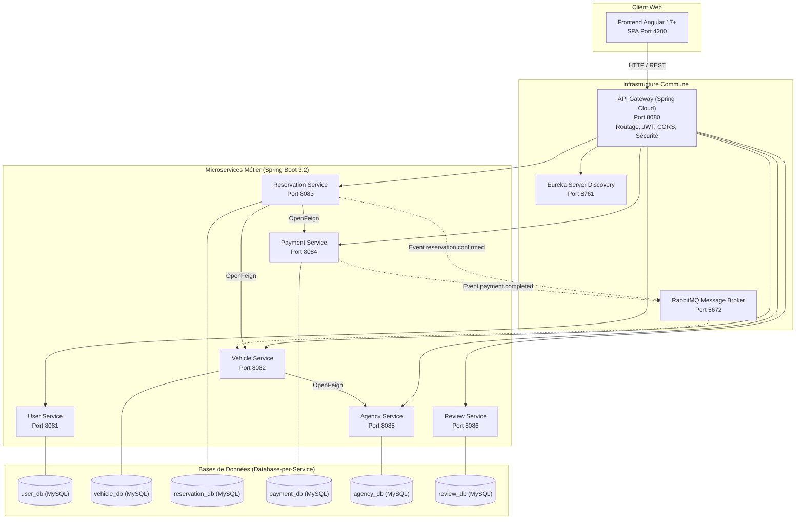

---

## 2. Diagramme de Cas d'Utilisation Général

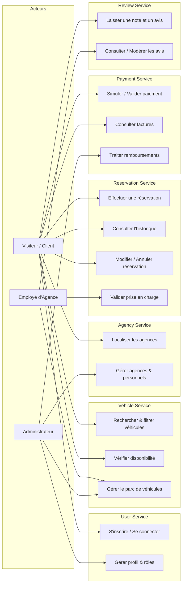

---

## 3. Diagrammes de Classes par Microservice

### 3.1. User Service
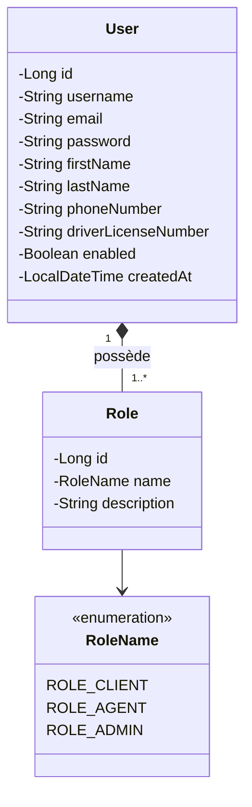

### 3.2. Vehicle Service
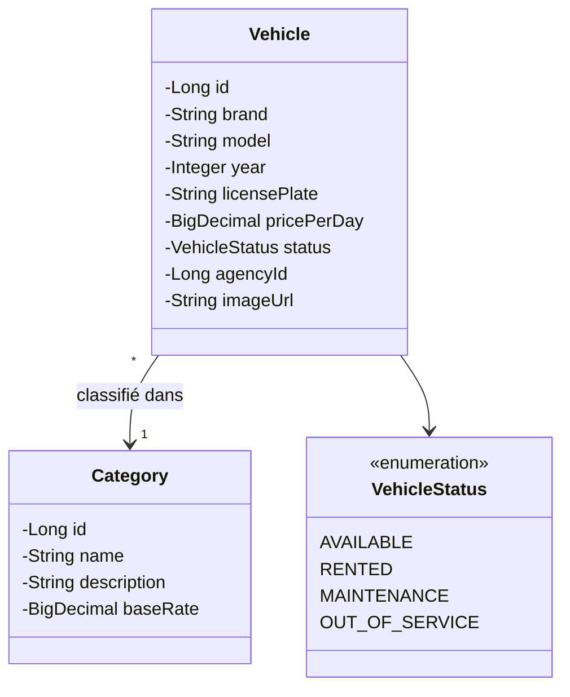

### 3.3. Reservation Service
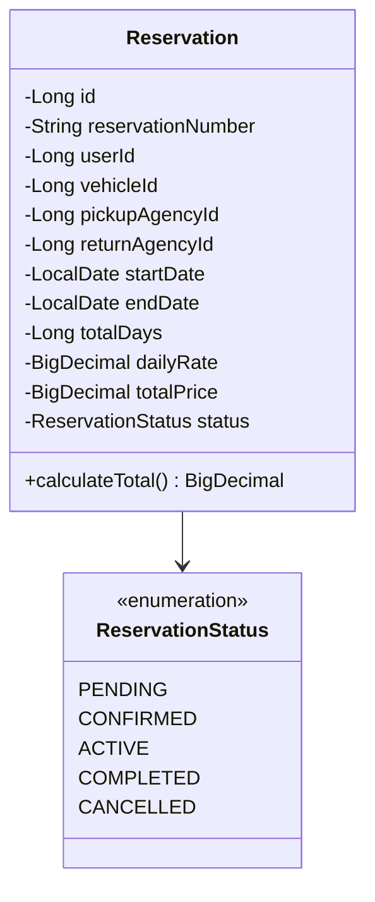

### 3.4. Payment Service
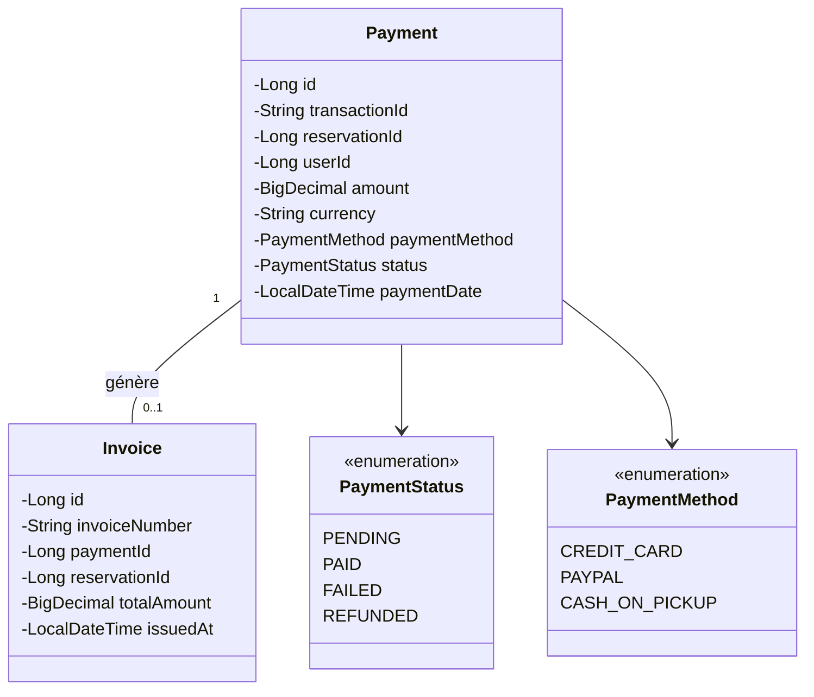

### 3.5. Agency Service
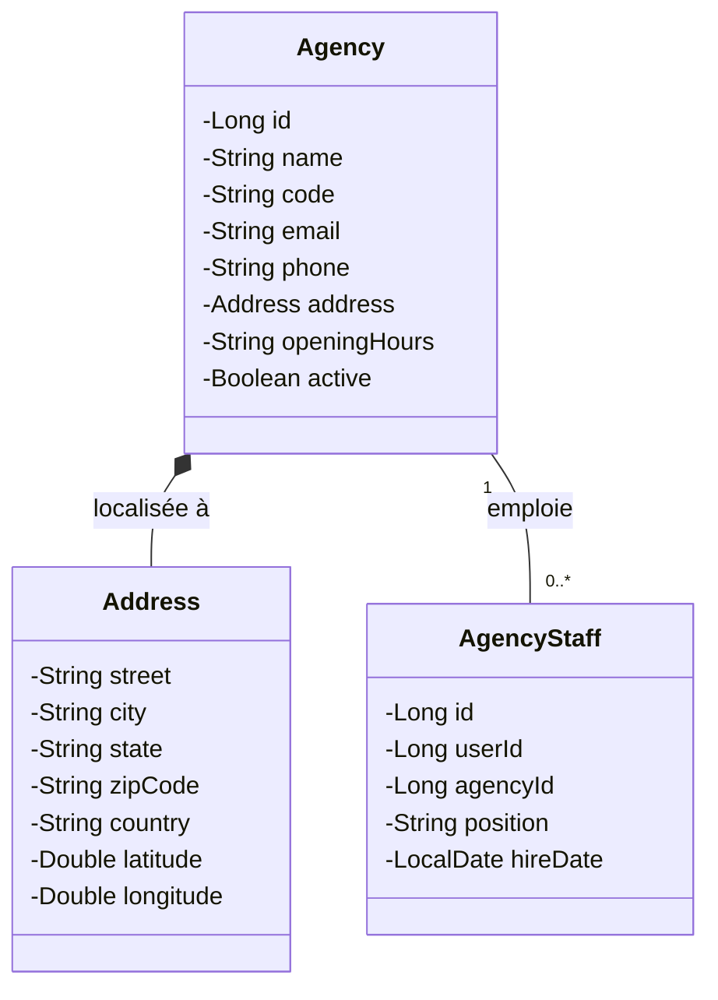

### 3.6. Review Service
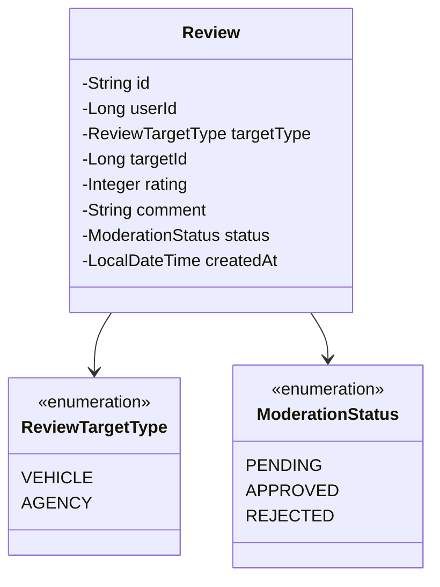

---

## 4. Diagramme de Séquence - Parcours Réservation Complet

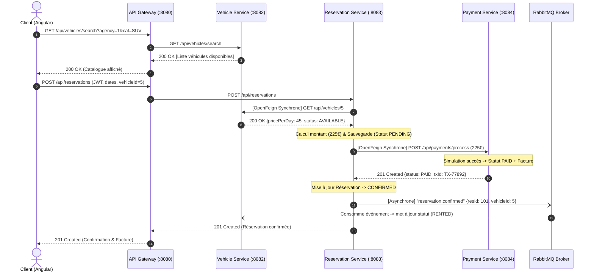

---

## 5. Diagramme de Communication Synchrone vs Asynchrone

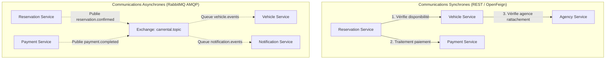

---

## 6. Diagramme de Déploiement Conteneurisé

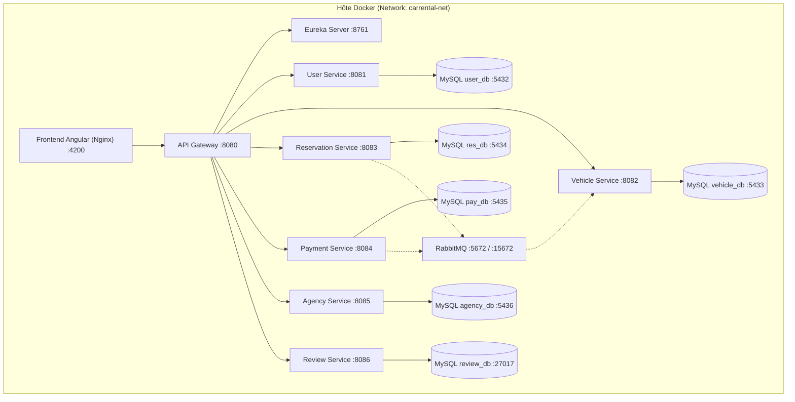
